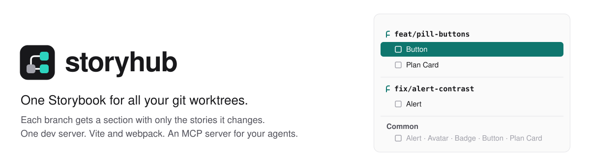
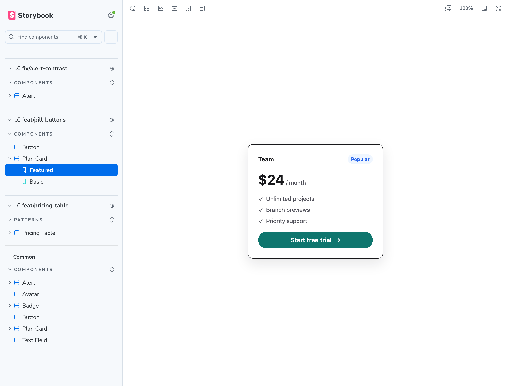
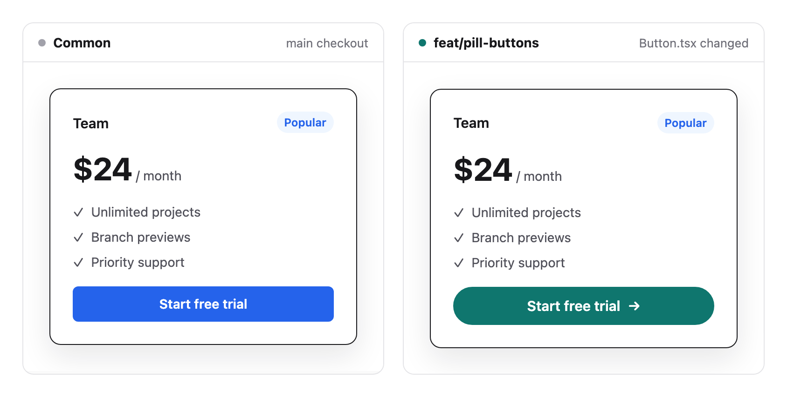
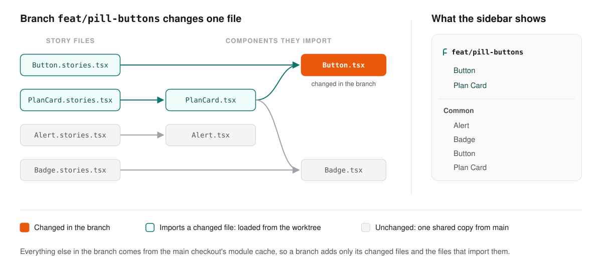

# storyhub

[](https://www.npmjs.com/package/storyhub) [](LICENSE)

One Storybook for all your git worktrees.

If you work on several UI changes at once, each in its own `git worktree`, storyhub shows them side by side in the Storybook you already run. Every worktree you opt in gets its own section at the top of the sidebar, listing only the stories its changes affect, and your normal stories stay underneath under "Common".



Everything still runs on one dev server, with one dependency install and one module cache. storyhub renders a branch's stories from the files that worktree changed, layered over your main checkout's modules. It also serves an MCP endpoint, so coding agents can see which stories each branch changes, why they're affected, and where to look at them.



Here is the same story in Common and in a branch that only changed `Button.tsx`. Plan Card shows up in the branch even though its own files didn't change, because it imports Button.

## Requirements

- Storybook 10.5 or newer, with a framework built on Vite or webpack 5. It's tested with `@storybook/react-vite` on Vite 6 and 8, and with `@storybook/react-webpack5` on webpack 5.112 with the SWC compiler. Other frameworks on those builders should work, but they haven't been tested yet.
- Node 20.19 or newer.
- Your branches checked out as worktrees of the repo that runs Storybook (`git worktree add ../my-feature -b my-feature`).

storyhub itself has no runtime dependencies.

## Install

Install storyhub in the package that runs Storybook. In a monorepo that's the app or workspace with the `.storybook` folder, which isn't always the repo root.

```sh
npm install --save-dev --save-exact storyhub
# or
yarn add --dev --exact storyhub
pnpm add --save-dev --save-exact storyhub
bun add --dev --exact storyhub
```

Then register the addon:

```ts
// .storybook/main.ts
const config: StorybookConfig = {
  // ...
  addons: [
    // ...your other addons
    'storyhub',
  ],
};
```

You can check the setup from that same package directory:

```sh
npx --no-install storyhub doctor
```

After that, start Storybook the way you always do (`npm run storybook`), usually from your main checkout. Whichever checkout runs it becomes the Common section, and `storyhub list` marks that one `★ hub` along with its URL. Nothing new shows up in the sidebar until you turn a branch on.

## Turn branches on

Branches are opt-in. From inside a worktree, you can turn that worktree on or off, or list them all:

```sh
npx --no-install storyhub on      # show the worktree you are in
npx --no-install storyhub off     # hide it again
npx --no-install storyhub list    # every worktree and whether it is on
```

From anywhere in the repo, including the main checkout, you name the one you mean:

```sh
npx --no-install storyhub on feat/login        # a branch, worktree directory name or path
npx --no-install storyhub on 'feat/*'          # a glob, saved as a pattern so future worktrees match too
npx --no-install storyhub off feat/old-thing   # switch one off even when a glob matches it
```

The running Storybook picks up the change within a second, without a restart.

The `--no-install` flag makes npx use the copy installed in your project and fail instead of downloading one from the registry. If a worktree has no `node_modules` of its own, run the command from a checkout that does have storyhub installed (usually the main checkout) and pass the branch name. Inside `package.json` scripts, plain `storyhub on` is enough.

Your selection lives in the repo's local `.git/config` as `storyhub.include` and `storyhub.exclude` entries. That means it's never committed, and every worktree of the repo sees the same selection.

## Tailwind

Tailwind builds its CSS from the class names it finds in your source files. The stylesheet Storybook loads belongs to your main checkout, so left alone, Tailwind only scans that checkout, and a class that appears only in a branch never gets generated. The branch's stories would then render without it. storyhub points Tailwind at your worktrees as well, and how it does that depends on your Tailwind version.

Tailwind 4 needs no setup. storyhub adds the enabled worktrees to any stylesheet that imports `tailwindcss`, using Tailwind's own `@source` directive, and covers both the automatic detection root and any `@source` paths you already list. When you turn a branch on, the stylesheet regenerates while Storybook keeps running. This works with both `@tailwindcss/vite` and `@tailwindcss/postcss`.

Tailwind 3 only reads its scan paths from its config file, so you wrap that config in `withStoryhub`:

```ts
// tailwind.config.ts
import { withStoryhub } from 'storyhub/tailwind';

export default withStoryhub({
  content: ['./index.html', './src/**/*.{ts,tsx}'],
  theme: { extend: {} },
});
```

This adds the same globs inside every worktree of the repo, but only while storyhub's dev Storybook is running, so your app's builds and other tools see the config unchanged. It includes every worktree rather than only the enabled ones because Tailwind 3 reads its config once at startup, and turning a branch on later shouldn't need a restart. The extra classes only end up in Storybook's dev CSS. If your config sets `content.relative: true`, pass its directory too: `withStoryhub(config, { base: __dirname })`.

## Let your agents do it

Agents working in a worktree can opt their own work in, so you don't have to. Add something like this to your `CLAUDE.md` or `AGENTS.md`:

```md
## Storybook
This repo uses storyhub. When you change UI in a worktree, make it visible in the shared Storybook by
running `npx --no-install storyhub on` inside the worktree (or `npx --no-install storyhub on <branch>`
from the main checkout). Run `npx --no-install storyhub off` when you are done. Use the `storyhub`
MCP tools to find the stories your branch affects, preview them (pass your story file's absolute path
or `branch`), and run their tests against your branch, which also flags regressions against Common.
```

## Connect MCP

storyhub serves an MCP endpoint from the running Storybook at `/storyhub/mcp`. If you also use `@storybook/addon-mcp`, you don't need a second server for it, because storyhub passes addon-mcp's tools, resources and prompts through and makes its preview and test tools work with branches. With Claude Code, put this in `.mcp.json`, changing the port to yours, and remove any separate `storybook` entry:

```json
{
  "mcpServers": {
    "storyhub": { "type": "http", "url": "http://localhost:6006/storyhub/mcp" }
  }
}
```

These are storyhub's own tools:

| Tool | Returns |
| --- | --- |
| `list-worktrees` | Every worktree, whether it is shown, and the commands to change that |
| `list-branches` | Shown branches with changed file counts, affected story counts and drift notes |
| `get-branch-changes` | A branch's changed files and every affected story, each with the import chain that explains why, plus URLs |
| `get-story-variants` | For a story id, its URL in Common and in every branch that changes it, for side-by-side comparison |

storyhub also wraps two of addon-mcp's tools so they understand branches. They keep addon-mcp's names and inputs, so its instructions still apply:

| Tool | What storyhub adds |
| --- | --- |
| Story preview (`preview-stories`, or `stories-preview` in addon-mcp 10.6) | Pass `branch`, or give a story by `absoluteStoryPath` inside a worktree, to get the branch's preview URL. It opens the story in its branch section, and addon-mcp's inline preview app renders the branch version. |
| `run-story-tests` | With a branch (or a story path inside a worktree), renders each story in headless Chromium, runs its play function and reports pass/fail plus addon-a11y results. Each branch story also runs in Common, and failures that only happen in the branch are flagged as regressions. Omit `stories` to test every story the branch changes. Without a branch, the call goes to addon-vitest as before. |

Every other addon-mcp tool, such as docs, story-writing instructions and changed stories, passes through unchanged. Without addon-mcp, storyhub still serves its own tools along with the preview and test tools. Branch tests use the Playwright your project already has for addon-vitest, and if Chromium is missing, `npx playwright install chromium` adds it.

The tools only read your repo. Turning branches on and off is done with the CLI.

## Clean up old worktrees

`storyhub clean` finds worktrees you can remove. It's a dry run unless you pass `--yes`:

```sh
npx --no-install storyhub clean                          # dry run: what could go and why
npx --no-install storyhub clean --older-than 30          # also list worktrees idle for 30+ days
npx --no-install storyhub clean --yes                    # remove the removable ones
npx --no-install storyhub clean --yes --delete-branches  # and delete their merged branches
```

A worktree counts as a candidate when its branch is merged into the base (`origin/HEAD`, or `main` if that isn't set), when every file it changed already matches the base (which catches squash and rebase merges), when it has no commits of its own, or when its last commit is at least `--older-than` days old. A few kinds are always kept:

- worktrees with uncommitted changes
- locked worktrees
- detached HEADs with commits that are not in the base

Removal uses `git worktree remove` without `--force`, and branch deletion uses `git branch -d`, so git itself refuses anything that would lose work. Removed worktrees also come off the opt-in list. Pass `--base <ref>` to compare against a different branch, or `--json` for scripts.

## Options

All of these are optional:

```ts
addons: [
  {
    name: 'storyhub',
    options: {
      mode: 'opt-in',            // or 'all': show every worktree unless excluded
      include: ['release/*'],    // patterns that are always on, for the whole team (merged with git config)
      exclude: ['*-scratch'],    // patterns that are always off
      branchesPosition: 'top',   // or 'bottom' to keep Storybook's default order
      commonLabel: 'Common',     // heading for the main checkout's stories
      upstreamMcp: '/mcp',       // addon-mcp endpoint to pass through, or false to turn that off
      allowedHosts: ['dev.box'], // extra hostnames that may reach storyhub's routes (see below)
    },
  },
],
```

storyhub's routes (`/storyhub/mcp` and `/__storyhub/*`) only answer requests addressed to an IP address, `localhost` or a `*.localhost` name, and they refuse requests sent by pages on other sites. That way a web page you happen to visit can't reach them through your browser. If you open Storybook under a different hostname, for example with `--host` on a shared machine, add it to `allowedHosts`. An entry that starts with `.` also allows its subdomains, and `true` turns the check off. The name you pass to Storybook's `--host` is allowed automatically.

## CLI reference

| Command | What it does |
| --- | --- |
| `storyhub on [target...]` | Show worktrees. No target means the worktree you are in. |
| `storyhub off [target...]` | Hide worktrees. |
| `storyhub list [--json]` | List every worktree and whether it is on. |
| `storyhub clean [--base <ref>] [--older-than <days>] [--delete-branches] [--yes] [--json]` | Find and remove merged or idle worktrees. Dry run unless `--yes`. |
| `storyhub status [--url <storybook url>] [--json]` | Affected stories and drift per branch, from the running Storybook (found automatically; `--url` overrides). |
| `storyhub doctor [-c <config dir>]` | Check that this package is set up correctly. |
| `storyhub --version` | Print the installed version. |

## How it works



For each branch that's turned on, storyhub:

1. Diffs the worktree against its merge base with your main checkout, including uncommitted and untracked files.
2. Walks the import graph from every story file with your builder's own resolver (Vite's or webpack's), so aliases, tsconfig paths and workspace packages resolve the same way they do in your app.
3. Marks a file dirty when it changed or when it imports something that did. The dirty story files are the ones the branch's section shows.
4. Serves the branch as a Storybook composition ref from the same dev server. Imports from branch modules resolve the way they would in your main checkout, and the target loads from the worktree only if it's dirty. Everything else is shared with the main checkout, so unchanged code is never transformed twice and React contexts stay single instances. With webpack, loader rules (`include`, `exclude`, `test`) are checked against the main checkout's path for worktree files, so those files get the same loaders.
5. If a branch dirties something your `.storybook/preview` imports, such as a context provider, loads the worktree's copy of the preview in that branch's iframe, so providers and consumers match.

Edits in a worktree hot-reload in its section, and adding stories, changing imports or turning a branch on or off updates the sidebar live.

## Notes on branch titles

A branch's title in the sidebar can carry a short note when something about the branch is worth knowing:

| Note | Meaning |
| --- | --- |
| `deps changed` | `package.json` or a lockfile changed in the branch. The branch still renders with your main checkout's dependencies. |
| `.storybook changed` | Storybook config other than preview files changed. Your main checkout's config is used. |
| `diverged` | Some files changed on both sides since the branch split. The branch's version is used. |
| `behind main` | Main changed files that sit between a story and the branch's changes. The branch renders its own older copy of those files, so rebase or merge main to see them current. |
| `missing deps` | The branch imports packages your main checkout cannot resolve, so those stories will error. |
| `no story changes` | The branch changes nothing a story imports. |

## Limitations

These are the known gaps, and [ROADMAP.md](ROADMAP.md) has the plan for each one:

- A story that main added after a branch split doesn't appear in that branch, because the worktree doesn't have it.
- `@storybook/addon-mcp` logs a "Skipping composed ref" warning at startup for each branch. You can ignore it, since addon-mcp keeps working and storyhub's MCP endpoint covers the branches.
- The sidebar is only reordered visually, so keyboard focus still follows Storybook's DOM order, which puts Common first.

## Contributing

```sh
pnpm install
pnpm lint           # oxlint, warnings fail the run (pnpm lint:fix applies safe fixes)
pnpm test           # unit tests against a generated fixture repo with real worktrees
pnpm test:e2e       # builds, runs a real Storybook dev server, drives it with Playwright and the MCP SDK client
pnpm fixture        # generate the fixture repo to explore by hand
pnpm screenshots    # regenerate the README screenshots in docs/images from a demo design system
```

This repo's own installs refuse package versions published less than 7 days ago and always save exact versions (see `pnpm-workspace.yaml`).

### Releasing

```sh
npm run release              # or: pnpm release
npm run release -- --full    # also run the browser E2E suite first
npm run release -- --dry-run # walk through every step without changing anything
npm run release -- --github  # create GitHub releases for pushed tags that don't have one yet
```

npm needs the `--` before the flags and pnpm doesn't (`pnpm release --github` works as is). If you forget it with npm, the script still sees the flag, because npm passes it along as an environment variable.

A release runs through these steps in order:

1. Check that you're on `main`, up to date with `origin`, and logged in to both npm and the GitHub CLI (`gh`).
2. If you have uncommitted work, let you stage it hunk by hunk with `git add -p`, then ask for a commit message right in the terminal.
3. Run the linter, typecheck and unit tests, so a failure stops the release before the version moves.
4. Ask whether this is a patch, minor or major release, and draft a `CHANGELOG.md` entry from the commit subjects since the last release tag.
5. Show the plan and wait for you to confirm it. You can open the changelog draft in your editor at this point.
6. Bump the version, commit, tag and push.
7. Run `pnpm publish`. If your npm account uses two-factor auth, pnpm asks for the code here.
8. Create the GitHub release, marked as latest, with the changelog entry as its notes.

Apart from the commit in step 2, nothing changes until you confirm the plan. If npm takes the version but the GitHub step fails, `npm run release -- --github` creates the missing release without redoing anything else.

The script is called `release`, not `publish`, because `pnpm publish` runs a script named `publish` itself.

## License

MIT
